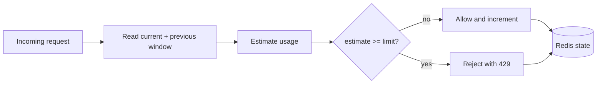

Rate limiting is one of those features everyone builds and almost nobody builds the same way twice. The first version is a counter in a map. The second version is a counter in Redis. The third version is the one you actually keep, and it looks nothing like the first two.

The reason is that a rate limiter is not a data structure problem. It is a policy problem that happens to run on a data structure.

## What you are really deciding

Every limiter answers three questions. If you skip them, the implementation decides for you, usually badly.

1. **What counts as a request?** A login attempt, an API call, a single user, or an entire tenant.
2. **What happens at the limit?** Reject, queue, degrade, or bill.
3. **What is the window?** Fixed, sliding, or token bucket.

The third question is the one people argue about on the internet. The first two determine whether your limiter is safe.

## The two honest algorithms

A fixed window counter is cheap and wrong at the boundary. A client can send twice its allowance in the seconds around a window reset. If the window is a minute and the limit is a hundred, a client can send two hundred in four seconds.

A sliding window log is exact and expensive. It stores a timestamp per request and trims the tail on every call. At a thousand requests per second that is a thousand writes per second, forever.

The middle ground is the sliding window counter: keep a counter for the current window and a counter for the previous one, then interpolate by how far you are into the current window. It costs two keys instead of a thousand writes and gets within a few percent of exact.

```ts
type Window = { current: number; previous: number };

export function allow(
  key: string,
  limit: number,
  windowMs: number,
  now: number,
): boolean {
  const bucket = Math.floor(now / windowMs);
  const state = readWindow(key, bucket); // two INCRs in one Lua script
  const weight = 1 - (now % windowMs) / windowMs;
  const estimate = state.previous * weight + state.current;
  if (estimate >= limit) return false;
  writeWindow(key, bucket); // TTL = 2 * windowMs
  return true;
}
```

The Lua script matters. Two separate Redis calls let a concurrent request slip through between them. One script is atomic and still cheap.

The decision path is short. The interesting part is which state it reads and what it does when that state is unavailable.



## Failure is a design input

The question that separates a demo from a production limiter is: what do you do when Redis is down?

Fail open and a downstream outage takes your limiter with it. Fail closed and a Redis blip becomes a full outage for your users. Most teams choose fail open with a local fallback budget, because a limiter that protects a dependency by killing the primary path has usually made things worse.

Instrument the choice. Count how often you fail open, and alert on it. A limiter that silently degrades is a limiter you do not have.

## What to measure before you tune

- Rejection rate by client, not just in aggregate.
- p99 latency of the limiter itself, including the network hop.
- Clock skew between nodes, if you run a local algorithm.
- The ratio of allowed to rejected traffic at the boundary.

A limiter that is correct on paper and slow in production is a denial-of-service tool aimed at yourself.

## References

- [Token bucket on Wikipedia](https://en.wikipedia.org/wiki/Token_bucket)
- Redis documentation on [eval and Lua scripting](https://redis.io/docs/programmability/)
- Cloudflare's engineering notes on limiting at the edge
