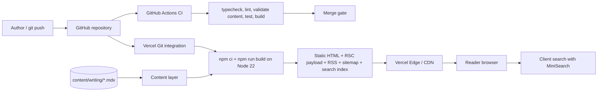
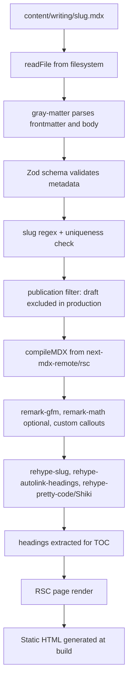
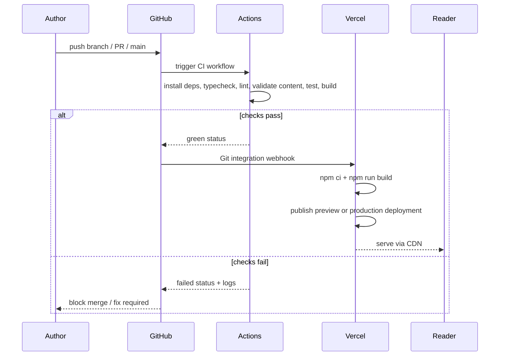
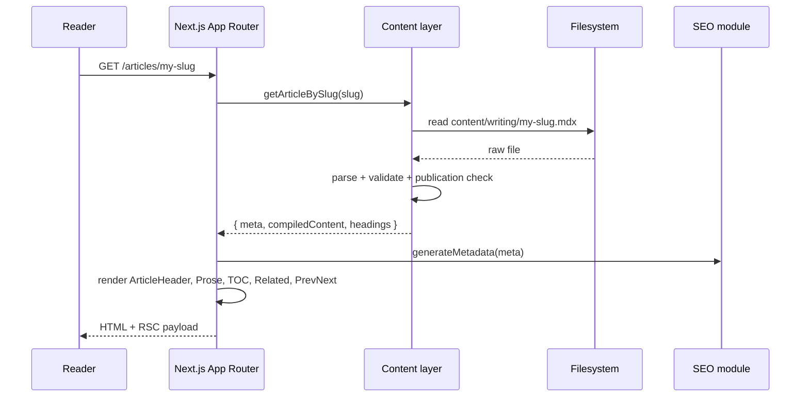
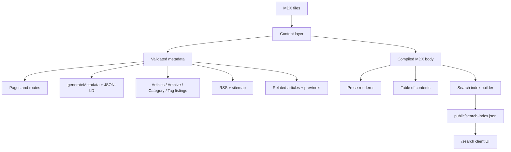
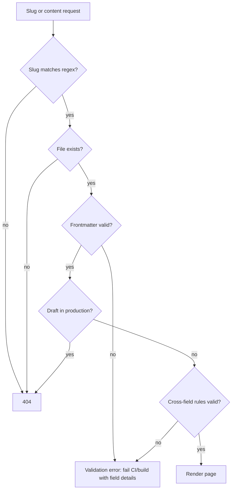

# Architecture — Personal Engineering Blog

| Field | Value |
|---|---|
| Document | System Architecture |
| Status | Draft — pending your review |
| Version | 0.1 |
| Date | 2026-11-19 |
| Owner | Sourav |
| Related documents | `PRD.md`, `IMPLEMENTATION_PLAN.md` |

---

## 1. Architecture principles

1. **Static-first.** Content is known at build time; no database, no runtime content API.
2. **Git is the CMS.** MDX files in the repository are the single source of truth.
3. **Publication safety by construction.** One filter governs every published surface.
4. **Server-first UI.** React Server Components by default; client JS only for genuine interactivity.
5. **Fail loudly.** Invalid content fails validation and the build.
6. **Small surface area.** Few dependencies, centralized tokens, no unnecessary abstraction.

---

## 2. High-level architecture



### Component responsibilities

| Component | Responsibility |
|---|---|
| GitHub repository | Stores code, MDX content, docs, and history; triggers CI and Vercel |
| GitHub Actions | Quality gate: typecheck, lint, content validation, tests, build |
| Vercel | Builds and hosts the application; provides preview and production deployments |
| Content layer | Reads MDX, validates frontmatter, enforces slugs and publication rules, compiles MDX |
| Next.js App Router | Routes requests, renders RSC/HTML, generates metadata and static params |
| Search index builder | Produces `public/search-index.json` at build time from published articles |
| Vercel CDN | Serves static assets globally with caching |
| Browser | Renders pages; runs only the small interactive islands |

---

## 3. Folder and component architecture

```text
src/
├── app/
│   ├── layout.tsx                 # Root shell, header, footer, global metadata
│   ├── page.tsx                   # Home
│   ├── globals.css                # Tailwind layers + semantic CSS variables
│   ├── not-found.tsx              # 404
│   ├── robots.ts                  # robots rules
│   ├── sitemap.ts                 # sitemap from published articles
│   ├── rss.xml/route.ts           # RSS feed from published articles
│   ├── articles/
│   │   ├── page.tsx               # Articles index + filters + pagination
│   │   └── [slug]/page.tsx        # Article detail
│   ├── categories/
│   │   ├── page.tsx               # Category hub
│   │   └── [slug]/page.tsx        # Category archive
│   ├── tags/
│   │   ├── page.tsx               # Tag hub
│   │   └── [slug]/page.tsx        # Tag archive
│   ├── search/page.tsx            # Search UI
│   ├── about/page.tsx             # About
│   └── archive/page.tsx           # Chronological archive
├── components/
│   ├── layout/                    # SiteHeader, SiteFooter, Breadcrumbs, Container
│   ├── content/                   # ArticleCard, ArticleList, CategoryLabel, TagLink, TopicGrid, FeaturedPanel
│   ├── article/                   # ArticleHeader, ArticleMeta, TableOfContents, Prose, CodeBlock, Figure, Callout, References, RelatedArticles, PrevNextNav, AuthorBox
│   └── ui/                        # SearchDialog, MobileNav, CopyButton, MermaidDiagram (lazy)
├── lib/
│   ├── content/                   # files.ts, schema.ts, loader.ts, publication.ts
│   ├── mdx/                       # compile.ts, plugins.ts
│   ├── search/                    # index.ts, client.ts
│   ├── seo/                       # metadata.ts, jsonld.ts
│   └── utils.ts                   # readingTime, dates, slugs
├── styles/
│   └── tokens.css                 # Design tokens (source of truth)
└── tests/
    ├── unit/
    ├── integration/
    └── e2e/
```

### Key components

| Component | Responsibility | Rendering |
|---|---|---|
| `SiteHeader` | Global navigation, search entry, mobile menu trigger | Server + small client island for mobile/search |
| `SiteFooter` | RSS, GitHub, email, copyright | Server |
| `Prose` | Styles MDX output using typography tokens | Server |
| `CodeBlock` | Dark-surface code presentation, language label, copy control | Server + tiny client copy button |
| `Figure` | Image/diagram with caption and alt text | Server |
| `MermaidDiagram` | Lazy client rendering of Mermaid source with static fallback | Client, lazy-loaded only when present |
| `TableOfContents` | Sticky desktop rail / collapsible mobile TOC | Server + tiny client active-state observer |
| `SearchDialog` | Full-text search UI using generated index | Client |
| `FeaturedPanel` | Dark-surface home feature block | Server |

---

## 4. MDX content-processing pipeline



### Decisions

- **`next-mdx-remote/rsc`** is used to compile MDX from the content directory. It supports React Server Components and works with static generation. It is isolated behind `lib/mdx/compile.ts`.
- **`gray-matter + zod`** handle frontmatter and validation. No unmaintained content framework is introduced.
- **Shiki via `rehype-pretty-code`** performs syntax highlighting at build time, keeping highlighting JavaScript out of the browser.
- **Mermaid** is rendered by a lazy client component only when a diagram is present. A `<details>` block containing the source and a caption is always rendered as a fallback. This avoids loading Mermaid on articles without diagrams.
- **KaTeX/math** is optional and disabled unless an article requires it.
- **Drafts** are visible only when `NODE_ENV === "development"`. Every deployed build excludes them.

### Frontmatter schema outline

```ts
ArticleFrontmatter = {
  title: string
  description: string
  date: ISODate
  updated?: ISODate
  category: CategoryEnum
  tags?: string[]
  series?: string
  seriesOrder?: number
  draft?: boolean
  featured?: boolean
  cover?: { src: string; alt: string }
  canonical?: URL
}
```

Cross-field rules: `updated >= date`; `seriesOrder` required when `series` exists; `cover.alt` required when `cover.src` exists; slugs match `^[a-z0-9]+(?:-[a-z0-9]+)*$` and are unique.

---

## 5. GitHub-to-Vercel deployment workflow



- `main` is the production branch.
- Pull requests create Vercel preview deployments.
- Preview deployments include `noindex` metadata and `X-Robots-Tag: noindex`.
- Vercel build command: `npm run build`. Node version: 22.
- Environment: `NEXT_PUBLIC_SITE_URL`, optional analytics ID. No secrets required for MVP.

---

## 6. Article routing and rendering flow



A request for an unknown, invalid, or draft slug returns 404 in production.

---

## 7. Data and metadata flow



All flows consume the same validated, publication-filtered dataset. There is no second source of truth.

---

## 8. Error handling and validation flow



Runtime errors use Next.js `not-found.tsx` and `error.tsx` boundaries. Validation errors are build-time failures, not silent fallbacks.

---

## 9. Security and performance considerations

### Security

- Only trusted MDX committed by the author is compiled. No user-submitted MDX, no remote content fetching.
- Slugs come from filenames, not user input.
- Publication filter prevents draft leakage into pages, feeds, sitemap, search, and related articles.
- Security headers: `X-Content-Type-Options: nosniff`, `Referrer-Policy: strict-origin-when-cross-origin`, `Permissions-Policy`, frame restrictions, HSTS via Vercel.
- CSP: nonce-based policy planned via middleware; inline Next.js scripts receive the nonce. `style-src` may require `'unsafe-inline'` for Tailwind output — to be verified during implementation.
- JSON-LD injected as escaped script content.
- Dependencies pinned; Dependabot and `npm audit` enabled.
- No secrets in repository; environment variables are public identifiers only.

### Performance

- Static generation with `generateStaticParams` for all published slugs.
- Server Components by default; `use client` only for search, mobile nav, copy buttons, TOC active state, theme control, and Mermaid.
- Build-time Shiki highlighting; no client syntax highlighter.
- Self-hosted WOFF2 fonts with `font-display: swap`.
- `next/image` with explicit dimensions and AVIF/WebP.
- Search index trimmed to title, description, tags, category, date, and a body excerpt.
- Bundle analysis with `@next/bundle-analyzer` before launch.

---

## 10. Technology decisions and trade-offs

| Decision | Rationale | Trade-off |
|---|---|---|
| Next.js 16 App Router + React 19 | Current stable stack, RSC, static generation | APIs must be verified against installed docs |
| Tailwind CSS 4 | Token-driven styling, fast iteration | CSS-first configuration differs from v3 |
| `next-mdx-remote/rsc` | Flexible file-based MDX with RSC | Compilation layer must be tested against Next 16 |
| Zod validation | Strict, typed frontmatter checks | Schema maintenance when metadata evolves |
| MiniSearch + generated JSON | No backend, predictable, small | Index grows with content; acceptable at target scale |
| No database/CMS | Matches requirements and reduces surface | No editorial UI or scheduling |
| Lazy Mermaid client component | Supports diagrams without loading Mermaid everywhere | Slight JS cost only on pages with diagrams |
| Newsreader font substitute | OFL licensed, editorial display character | Not identical to commercial Signifier |

---

## 11. Testing architecture

| Layer | Tool | Scope |
|---|---|---|
| Unit | Vitest | Slug rules, reading time, date handling, metadata normalization, publication filter |
| Component | React Testing Library | Header, footer, article cards, code block, TOC, search UI |
| Integration | Vitest + Next test utilities | Routes render, metadata generation, RSS/sitemap content |
| Content validation | Custom script | All MDX files valid, slugs unique, no draft in build output |
| E2E | Playwright | Navigation, search, mobile menu, article rendering, prev/next, 404 |
| Accessibility | axe-core via Playwright | Keyboard, focus, alt text, contrast-sensitive checks |
| Build | `npm run build` | Full static generation must succeed |

---

## 12. Open decisions carried from PRD

Domain, repository name/visibility, folder rename, audience priority, analytics, comments, newsletter, contact handling, and documentation visibility. These do not block this architecture but must be resolved before final launch configuration.
