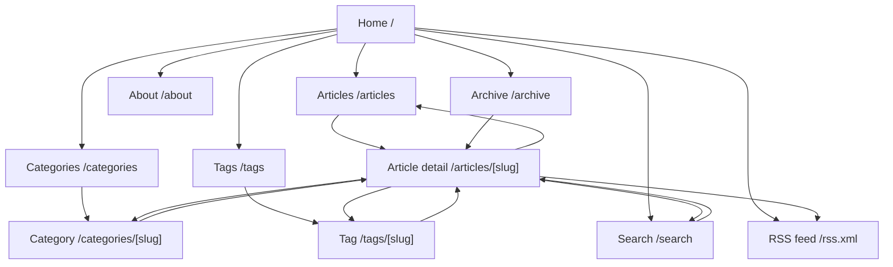

# Design Specification — Personal Engineering Blog

| Field | Value |
|---|---|
| Document | Design Specification |
| Status | Approved by Sourav on 2026-11-19 |
| Version | 1.0 |
| Visual reference | Cora.computer (inspiration only, not cloned) |
| Related documents | `PRD.md`, `ARCHITECTURE.md`, `IMPLEMENTATION_PLAN.md` |

---

## 1. Visual direction

The publication uses an **editorial, minimalist visual language** inspired by the supplied Cora.computer analysis. It is not a conventional blog template and not a terminal interface. Terminal-inspired details are limited to technical labels, code blocks, and engineering metadata.

Preserved reference qualities:

- Black, white, and blue palette
- Combination of light and dark surfaces
- Strong typographic hierarchy
- Generous whitespace
- Refined typography and restrained decoration
- Carefully designed borders, surfaces, and shadows

---

## 2. Font licensing decisions

| Role | Font | License / status | Decision |
|---|---|---|---|
| Interface and body | **Switzer** | Free via Fontshare, ITF Free Font License; commercial use and self-hosting allowed; license file must be retained | Use, self-host WOFF2 |
| Editorial display | **Newsreader** | Open Font License (OFL) | Approved substitute for commercial Signifier |
| Selected editorial text | **Times** | System serif (`Times New Roman`, `Times`); Liberation Serif (OFL) as fallback | Use system stack |
| Technical labels / code | JetBrains Mono / system mono | JetBrains Mono is OFL | Use mono stack |

Signifier (Klim Type Foundry, commercial) and any private Cora.computer font assets are **not** bundled.

---

## 3. Website structure



Navigation flow: global header links to Articles, Categories, Archive, Search, About. Home is a curated entry point. Article pages link back to category/tag, related articles, previous/next, and RSS. Every page is reachable within one or two hops.

---

## 4. Homepage wireframe

```text
┌──────────────────────────────────────────────────────┐
│ MASTHEAD                                             │
│ Wordmark        Articles  Categories  Archive  About │
│                 Search ⌘K                            │
├──────────────────────────────────────────────────────┤
│ ABOVE THE FOLD                                       │
│ Utility label: ENGINEERING / RESEARCH / 2026         │
│ Display heading (Newsreader, 55/64.9)                │
│ "Systems, examined carefully."                       │
│ Short philosophy paragraph (16/24, max 60ch)         │
│ [Browse writing →]   [Search notes]                  │
│ ────────────────────────────────────────────────────  │
│ FEATURED ARTICLE — dark surface #1d1b20              │
│ Category label · Editorial title · Description       │
│ Meta: date · reading time · [Read article]           │
├──────────────────────────────────────────────────────┤
│ BELOW THE FOLD                                       │
│ LATEST WRITING — rule-separated list, not cards      │
│   01 / Title / category / date                       │
│   02 / Title / category / date                       │
│   03 / Title / category / date                       │
│ RESEARCH & ENGINEERING NOTES — secondary list        │
│ TOPICS — restrained black/white/blue label grid      │
│ MINIMAL FOOTER — RSS · GitHub · Email · ©            │
└──────────────────────────────────────────────────────┘
```

Hierarchy comes from whitespace, rules, and type scale — not stacked cards. The dark featured panel supplies the light/dark surface contrast without turning the site into a terminal.

---

## 5. Article page wireframe

```text
┌──────────────────────────────────────────────────────────┐
│ Header / breadcrumb: Home / Articles / Category          │
├──────────────────────────────────────────────────────────┤
│ Utility: CATEGORY · SERIES                               │
│ Display title (Newsreader, 55/64.9)                      │
│ Description / dek (editorial serif, 18–20px)             │
│ Meta row: Published · Updated · Reading time · Tags      │
│ [Copy link] [Share]                                      │
├──────────────────────────────┬───────────────────────────┤
│ READING COLUMN (~680px)      │ RIGHT RAIL (sticky)       │
│ Body: Switzer 16/24          │ Table of contents         │
│ H2: Newsreader 36/43.2       │ 1. Section                │
│ Code block: dark surface     │ 2. Section                │
│ Figure + caption             │ 3. Section                │
│ Callout / note               │                           │
│ References [1] [2]           │                           │
├──────────────────────────────┴───────────────────────────┤
│ Related articles (3)                                     │
│ Previous / Next navigation                               │
│ Author box + RSS prompt                                  │
│ Footer                                                   │
└──────────────────────────────────────────────────────────┘
```

On mobile, the right rail becomes a collapsible table of contents above the article body. The reading column stays at 16/24 with a 65–75 character measure.

---

## 6. Design token mapping

### Semantic colour tokens

| Semantic token | Value | Source | Use |
|---|---|---|---|
| `--color-ink` | `#000000` | Observed | Primary text on light |
| `--color-paper` | `#ffffff` | Observed | Page background |
| `--color-surface-alt` | `#ebebeb` | Observed | Subtle surfaces |
| `--color-border` | `#dadada` | Observed | Rules and borders |
| `--color-muted` | `#7d7d7d` | Observed | Secondary text |
| `--color-muted-light` | `#a1a1a1` | Observed | Tertiary text / dark muted |
| `--color-accent` | `#117bc8` | Observed | Primary blue, links, focus on light |
| `--color-accent-blue` | `#0ea5e9` | Observed | Accent variant |
| `--color-accent-sky` | `#38bdf8` | Observed | Accent on dark surfaces |
| `--color-accent-soft` | `#7dd3fc` | Observed | Soft highlight |
| `--color-dark-surface` | `#1d1b20` | Observed | Featured panel, code blocks, footer |
| `--color-dark-border` | `#3a3a3a` | Derived | Borders on dark surfaces |
| `--color-on-dark` | `#ffffff` | Observed | Text on dark surfaces |
| `--color-on-dark-muted` | `#a1a1a1` | Observed | Muted text on dark |

Derived values are implementation decisions, not reference measurements.

### Typography tokens

| Role | Font | Size / line-height | Source |
|---|---|---|---|
| Utility label | Switzer | 12px / 16px | Observed size; line-height derived |
| Secondary body | Switzer | 14px / 20px | Observed |
| Body | Switzer | 16px / 24px | Observed |
| Editorial heading | Newsreader | 36px / 43.2px | Observed |
| Section heading | Newsreader | 45px / 45.9px | Observed |
| Display heading | Newsreader | 55px / 64.9px | Observed |
| Technical labels / code | Mono stack | 12–14px | Implementation decision |

### Spacing, containers, borders, shadows

| Token family | Values | Source |
|---|---|---|
| Spacing | `4 / 8 / 12 / 16 / 24 / 32 / 48 / 64 / 96px` | Implementation decision |
| Reading container | `680px` | Implementation decision |
| Content container | `1120px` | Implementation decision |
| Wide container | `1280px` | Implementation decision |
| Border width | `1px` | Implementation decision |
| Radius | `0–2px` | Implementation decision |
| Shadow sm | `0 1px 2px rgb(0 0 0 / 0.04)` | Implementation decision |
| Shadow md | `0 8px 24px rgb(0 0 0 / 0.06)` | Implementation decision |
| Focus ring | `2px solid var(--color-accent)`, offset `2px` | Guidance + decision |

### Component states

| State | Treatment |
|---|---|
| Default | Stable layout, no visual shift |
| Hover | Subtle background or border change; 150–250ms |
| Focus-visible | 2px accent ring, 2px offset |
| Active / selected | Accent text or border, never colour alone |
| Disabled | Reduced emphasis, non-interactive, clear semantics |

---

## 7. Component hierarchy

**Layout shell:** `SiteHeader`, `SiteFooter`, `Container`, `Breadcrumbs`, `SkipLink`

**Content discovery:** `ArticleCard`, `ArticleList`, `CategoryLabel`, `TagLink`, `TopicGrid`, `FeaturedPanel`

**Article reading:** `ArticleHeader`, `ArticleMeta`, `TableOfContents`, `Prose`, `CodeBlock`, `Figure`, `Callout`, `References`, `RelatedArticles`, `PrevNextNav`, `AuthorBox`

**Interactive islands (client only):** `SearchDialog`, `MobileNav`, `CopyButton`, `MermaidDiagram`, `ThemeToggle` (only if separately approved)

All other components are React Server Components.

---

## 8. Responsive strategy

| Breakpoint | Navigation | Layout | Article | Code / diagrams |
|---|---|---|---|---|
| `< 640px` | Hamburger | Single column, generous gutters | TOC in `<details>` above body; 16/24 body | Code scrolls horizontally; diagrams `max-width: 100%` with captions |
| `640–767px` | Hamburger / compact | Single column, wider margins | Same as above | Same; tap targets ≥44px |
| `768–1023px` | Inline nav | Content container | TOC above article | Figures scale within container |
| `1024–1279px` | Full global nav | Article + right rail | Sticky TOC, 55px display title | Wider diagrams permitted |
| `≥ 1280px` | Full nav | Wide container, larger gutters | Increased whitespace | Diagrams may use wide container |

Validation checklist: desktop navigation, tablet layout, mobile navigation, article typography, code block overflow, diagram responsiveness, image scaling — all verified in browser during implementation.

---

## 9. Originality

Cora.computer is used only as a visual reference for palette, typographic hierarchy, whitespace, and light/dark surface contrast. Its branding, proprietary assets, text, and exact page composition are not copied. The blog has its own wordmark, voice, content structure, and component system.

---

## 10. Approval

This specification was reviewed and approved by Sourav on 2026-11-19. Newsreader was selected as the open substitute for the commercial Signifier font. Implementation may proceed once `PRD.md`, `ARCHITECTURE.md`, and `IMPLEMENTATION_PLAN.md` are also approved and the open product decisions in the PRD are confirmed.
